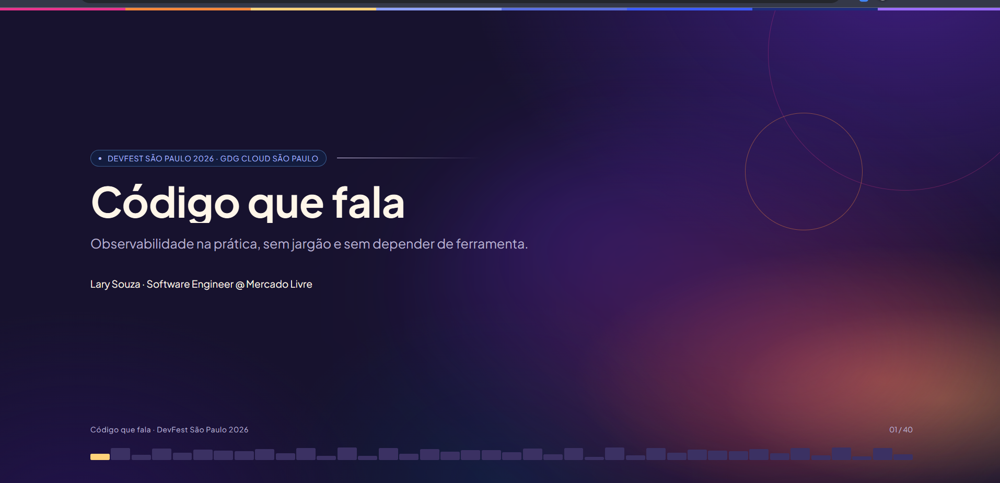
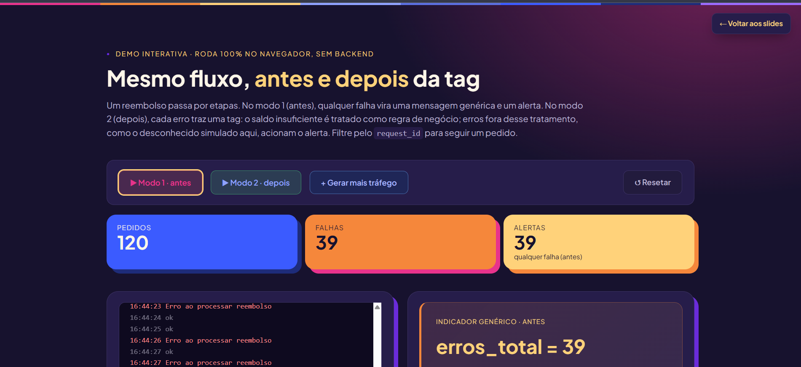

# Palestra: Código que fala

<p align="center">
  <strong>Observabilidade na prática, sem jargão e sem depender de ferramenta.</strong><br>
  Larissa Souza · DevFest São Paulo 2026 · GDG Cloud São Paulo
</p>

<p align="center">
  <a href="https://eu-larissasouza.github.io/devfest2026-codigo-que-fala/"></a>
  <a href="https://eu-larissasouza.github.io/devfest2026-codigo-que-fala/demo.html"></a>
  
  
  
  
  <a href="LICENSE"></a>
</p>

<p align="center">
  <a href="https://eu-larissasouza.github.io/devfest2026-codigo-que-fala/"><strong>Ver os slides</strong></a> ·
  <a href="https://eu-larissasouza.github.io/devfest2026-codigo-que-fala/demo.html"><strong>Abrir a demo</strong></a> ·
  <a href="https://github.com/eu-larissasouza/devfest2026-codigo-que-fala">Repositório</a>
</p>

## Sobre a palestra

Esta palestra parte de um caso de falha em um fluxo de reembolso para mostrar como logs, métricas e alertas ajudam a descobrir onde olhar — sem depender de uma ferramenta específica. O foco é distinguir uma regra de negócio conhecida e tratada de uma falha que precisa ser investigada.

Palestra programada para 28/11/2026, na FIAP Paulista, como parte do DevFest São Paulo 2026.

## Acesso rápido

- **Apresentação:** [abrir os slides](https://eu-larissasouza.github.io/devfest2026-codigo-que-fala/)
- **Demo interativa:** [abrir a demo](https://eu-larissasouza.github.io/devfest2026-codigo-que-fala/demo.html)
- **Código-fonte:** [eu-larissasouza/devfest2026-codigo-que-fala](https://github.com/eu-larissasouza/devfest2026-codigo-que-fala)

## 📸 Prévia

| Apresentação | Demo interativa |
| --- | --- |
| [](https://eu-larissasouza.github.io/devfest2026-codigo-que-fala/) | [](https://eu-larissasouza.github.io/devfest2026-codigo-que-fala/demo.html) |
| [👉 Abrir os slides](https://eu-larissasouza.github.io/devfest2026-codigo-que-fala/) | [👉 Abrir a demo](https://eu-larissasouza.github.io/devfest2026-codigo-que-fala/demo.html) |

## O material

- **30 slides** com navegação por teclado, clique e gesto em telas sensíveis ao toque.
- O **slide 2** reúne os links para a apresentação, a demo e o repositório.
- O **slide 24** introduz a demo; o **slide 30** tem o perfil do LinkedIn e o QR code.
- A demo simula um reembolso em quatro etapas, com dados gerados no navegador e sem servidor.
- O layout se adapta a desktop, tablet e celular.

## Estrutura do repositório

```text
devfest-codigo-que-fala/
├── index.html       # Slides; estilos e navegação embutidos
├── demo.html        # Demo interativa
├── img/             # Foto, favicon e elementos visuais
├── screenshots/     # Prévia dos slides e da demo
│   ├── slides-preview.png
│   └── demo-preview.png
├── style.css        # Arquivo auxiliar, não carregado pelo deck atual
├── deck.js          # Arquivo auxiliar, não carregado pelo deck atual
├── LICENSE
└── README.md
```

## Rodar localmente

Não há dependências nem etapa de build. Abra `index.html` no navegador ou inicie um servidor estático na pasta do projeto:

```bash
python -m http.server 8000
```

Depois, acesse `http://localhost:8000`. Para abrir a apresentação, basta manter `index.html` e a pasta `img/` juntos; para a demo, mantenha `demo.html` na mesma pasta. `style.css` e `deck.js` não são usados pela versão publicada.

Os QR codes são gerados por uma biblioteca carregada via CDN e precisam de internet para aparecer. Os respectivos links também estão escritos nos slides.

## Demo interativa

O fluxo simulado passa por `receber_pedido`, `validar_saldo`, `solicitar_reembolso` e `montar_tela`.

- **Modo 1 · antes:** logs genéricos; toda falha gera alerta, inclusive saldo insuficiente.
- **Modo 2 · depois:** logs com `level`, `error_type`, `step` e `business_rule_handled`. Uma regra de negócio tratada (`true`) não alerta; falhas fora dela (`false`), inclusive desconhecidas, alertam para investigação.
- O filtro encontra eventos por `request_id`. O botão de reset limpa o filtro, volta ao modo 1 e gera uma nova rodada de dados fictícios.

## Navegação

Use as setas, espaço ou Page Up/Page Down. Em celular, também é possível avançar e voltar com gestos. Pressione **N** para mostrar ou esconder as notas do apresentador. O id `slide-demo` deve ser mantido: a demo o usa para voltar ao slide correspondente.

## Licença

Este repositório inclui uma licença MIT; consulte [`LICENSE`](LICENSE). A licença do conteúdo autoral da apresentação está indicada no slide de referências.

## Contato

- LinkedIn: [in/larissa-a-souza](https://www.linkedin.com/in/larissa-a-souza/)
- Instagram: [@\_lary.souza.\_](https://instagram.com/_lary.souza._)
- YouTube: [@lary.souzaa](https://www.youtube.com/@lary.souzaa)
- GitHub: [eu-larissasouza](https://github.com/eu-larissasouza)

---

<p align="center">Aprecie cada momento da sua jornada. 💜</p>
